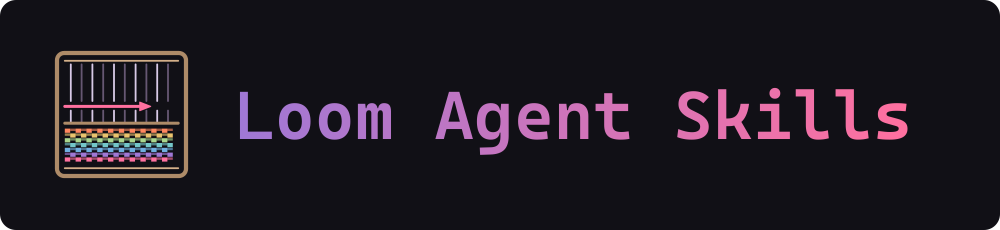

<p align="center">
  
</p>

[AMD Loom](https://rocm.github.io/hrx-system/loom/) is a new kind of inference stack where support and optimizations for models live outside the inference server. This enables model programs to be added, optimized, and shared by anyone! `loom-skills` equips your Claude, Codex, or Pi agent with everything it needs to author and serve optimized model programs for AMD Strix Halo GPUs.

## Quick Start

Claude Code:

```text
/plugin marketplace add loom-fun/loom-skills
/plugin install loom@loom
```

Codex and Pi, using [the skills CLI](https://github.com/vercel-labs/skills):

```bash
npx skills add loom-fun/loom-skills --skill '*'
```

Once the skill is installed, prompt your agent:

```
get <hf-org>/<model> working on loom-serve, optimize it, and report the performance relative to llamacpp rocm
```

## Use

`loom-skills` gives your agent the following capabilities. Ask for the outcome you
want; the agent selects the relevant skills automatically. You can also invoke a
skill directly.

| Skill | Purpose |
|---|---|
| `loom` | Choose the workflow and apply shared operating rules |
| `loom-setup` | Install Loom, fetch catalog models, and manage GPU or NPU servers |
| `loom-demo-ui` | Open a browser playground for chat, audio, images and embeddings |
| `loom-port-llm` | Turn a GGUF model into a runnable Loom package |
| `loom-roofline` | Estimate performance limits and choose targets and a budget |
| `loom-optimize` | Improve a port's speed while checking correctness |
| `loom-benchmark` | Validate a port, measure it against llama.cpp, and generate reports |
| `loom-improve` | Improve and evaluate the skills themselves |
| `loom-org` | Port, publish and maintain a collection of models on Hugging Face |

### Example requests

For an end-to-end port, optimize and report request, you get a runnable Loom model
package, a local server, and HTML and Markdown reports with supporting logs.
The report includes performance against llama.cpp, validation results and remaining limits.

Ask in plain language:

- "Install Loom and serve moonshine."
- "Port Qwen3-4B-Instruct-2507 and validate it against llama.cpp."
- "Open a browser playground for my running model."
- "Benchmark my Loom port."
- "Optimize this model."
- "Is 50% faster decode achievable for this model?"

### Control the effort

The agent estimates a time budget for the whole job; optimizing an existing port
defaults to 30 minutes. Downloads, new architectures and long-context tests can
extend the estimate. Set your own time limit or target in the prompt:

- "Spend up to 3 hours porting, optimizing and reporting on this model."
- "Aim for decode 50% faster than llama.cpp, within a 2-hour budget."

### Model Catalog

The authors of this project have ported, optimized, and uploaded over 50 `loom-serve` compatible model cards to [https://huggingface.co/loom-fun](https://huggingface.co/loom-fun). Each of these model cards was produced using `loom-skills` and improves upon a `llama.cpp` baseline for Strix Halo hardware.

## Workflow details

The agent handles setup and works through four stages:

| Stage | What your agent does | Result |
|---|---|---|
| **1. Port** | Reuses existing work, builds the model package, and tests basic behavior | A working model served locally |
| **2. Measure** | Checks correctness and benchmarks Loom against llama.cpp | A baseline and realistic speed targets |
| **3. Optimize** | Tries improvements, measures the gains, and rechecks correctness | The best verified build found within the budget |
| **4. Report** | Runs final validation and records performance and limitations | A runnable package and comparison report |

The agent can download Loom from PyPI and releases from
`lemonade-sdk/llamacpp-rocm` without asking. It asks when a model requires license acceptance or
an executable from another source needs approval.

### Model features

The skills check if the target model has any of these features, and will enable and test them if possible:

| Feature | Description |
|---|---|
| Chat format | Uses the model's own message template and special tokens |
| Tool calling | Supports tool requests and results when the template supports tools |
| History reuse | Reuses conversation state across turns |
| Reasoning | Exposes the model's supported thinking controls |
| Sampling | Supports temperature, top-k, top-p and seeded generation |
| Context length | Aims for native context, subject to kernel and memory limits; reports the configured limit |
| Image input | Adds vision when a supported projector is available |
| Speculative decoding | Keeps drafting enabled when tuning shows a speed improvement |

### Program validation

The skills use these validation gates to assess whether a model program is correct:

| Gate | What it checks |
|---|---|
| Reference comparison (`golden`, `compare`) | Compares generated tokens with llama.cpp, allowing documented numerical near-ties |
| Tool loop (`agent`) | Checks multi-turn tool calls, results and history reuse |
| Thinking off (`agent_think_off`) | Repeats the tool loop with reasoning disabled, when supported |
| Concurrency (`consistency`) | Checks that concurrent and sequential requests agree and repeated greedy requests are deterministic |
| Sampling (`sampling`) | Checks greedy behavior, seeded reproducibility and sampling distributions |
| Vision (`vision`) | Compares image-conditioned outputs with llama.cpp when image input is enabled |
| Drafting (`spec`) | Checks that speculative decoding preserves undrafted output |
| Long context (`needle`) | Checks retrieval from a long prompt against llama.cpp |
| Context limit (`needle_full`) | Checks retrieval at the configured context limit on Loom alone |

## Runtime requirements

- Linux or Windows 11 (Git Bash), and an AMD GPU (ROCm-class; developed on gfx1151). The NPU path needs an XDNA device.
- Python ≥ 3.12 with `venv`, and `git`. The SDK comes from PyPI
  ([`hrx-loom`](https://pypi.org/project/hrx-loom/), Linux glibc ≥ 2.39 or Windows 11).
  `gh` is only needed for development wheels from CI (`install_loom.sh ROOT ci-latest`).

## Repository layout

```
.claude-plugin/{plugin.json,marketplace.json}   # plugin + single-plugin marketplace
skills/<skill>/SKILL.md                          # nine shared skills, with scripts and references
scripts/install_skills.py                        # native discovery adapters and managed copy install
install.sh                                       # Bash wrapper for the Python installer
LICENSE                                          # MIT
THIRD_PARTY_NOTICES.md
```

## Other Installation Details

Install the complete suite with [the skills CLI](https://github.com/vercel-labs/skills) (requires Node.js):

```bash
npx skills add loom-fun/loom-skills --skill '*'
```

Choose Claude Code, Codex or Pi when prompted. This installs into the current
project; add `-g` for all projects. Install all nine skills together: they share
sibling scripts. Start a fresh agent session afterward.

| Agent | Project skill directory | Invocation |
|---|---|---|
| Claude Code | `.claude/skills` | `/loom` |
| Codex | `.agents/skills` | `$loom` |
| Pi | `.agents/skills` | `/skill:loom` |

Update with `npx skills update`; remove with `npx skills remove`.

**Without Node.js:** use the Python 3.12+ fallback (standard library only):

```bash
git clone https://github.com/loom-fun/loom-skills
cd loom-skills
python3 scripts/install_skills.py
# Windows PowerShell: python scripts/install_skills.py
```

The fallback installs for all three agents in their user skill directories.
Use `--agent codex` to target one agent, `--dest PATH` for a custom directory,
and `--uninstall` to remove unchanged copies. It preserves unmanaged and locally
modified skills.

**Claude Code plugin.** The existing plugin and automatic skill-directory substitution remain supported:

```text
/plugin marketplace add loom-fun/loom-skills
/plugin install loom@loom
```

Use either the plugin or a skills install in Claude to avoid duplicates.
Update the plugin with `claude plugin marketplace update loom && claude plugin update loom@loom`.
Private repositories require read access and working Git credentials for either installation method.

## Contributing

This project is not accepting pull requests at this time.

If you want to test your own fork:

```bash
python3 -m unittest discover -s tests -v
```

CI runs these regressions on Linux and Windows. See [compatibility checks](docs/agent-compatibility.md)
for fresh-agent smoke tests and GPU trials.

## License

MIT; see [LICENSE](LICENSE). Bundled third-party material keeps its own license; see
[THIRD_PARTY_NOTICES.md](THIRD_PARTY_NOTICES.md).
